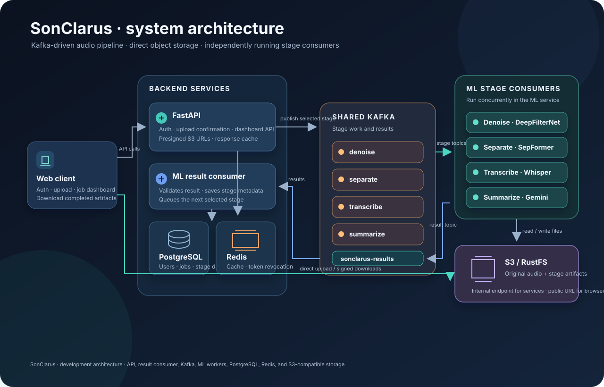
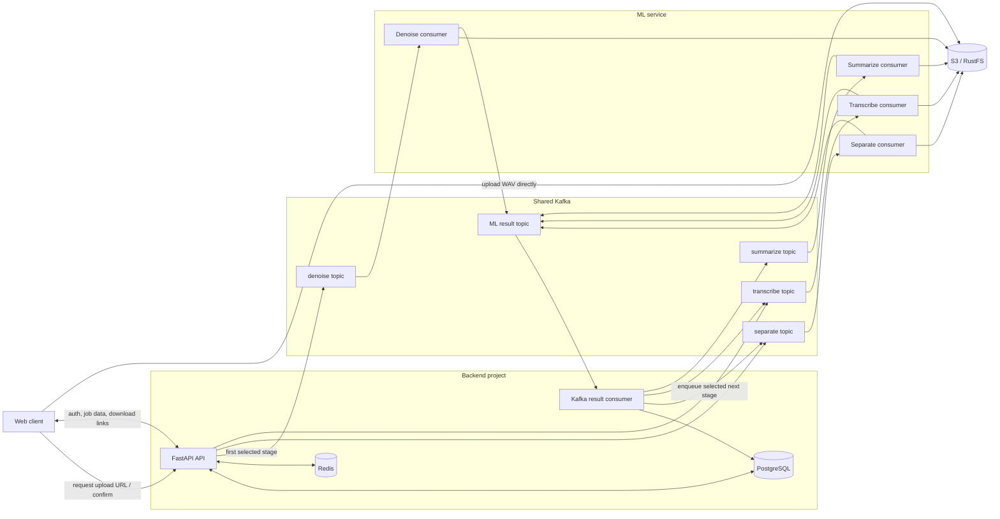
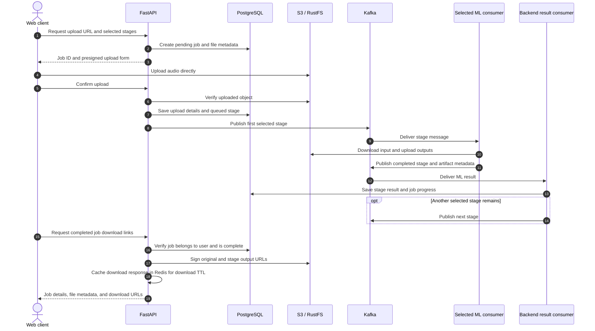

# SonClarus

## Audio processing, from upload to insight

A self-hostable audio intelligence service for cleaning, separating, transcribing, and summarizing recordings.

**Backend:** Python 3.14, FastAPI, PostgreSQL, Redis, and Kafka.

**ML workers:** Python 3.11, DeepFilterNet, SepFormer, Faster Whisper, and Gemini.

[Backend guide](backend/README.md) | [ML guide](ml/README.md) | [Architecture diagram](architecture.svg)

| Stage | Model or service |
|---|---|
| Denoise | DeepFilterNet |
| Separate | SepFormer |
| Transcribe | Faster Whisper |
| Summarize | Gemini API |

---

## What SonClarus does

SonClarus accepts WAV audio through a direct-to-object-storage upload. The backend tracks each job, sends stage events through Kafka, and stores metadata and results in PostgreSQL. The ML service consumes work for four independent stages and uploads its artifacts to S3-compatible storage such as RustFS.

Select the stages needed for a job. Summarization requires transcription. When the selected stages finish, the backend marks the job complete and provides short-lived download links for the original and generated files.

> **Designed for two-speaker audio.** The separation model produces two speaker tracks; this pipeline is not intended for larger panels.

## Architecture

The API and ML workers are separate services. Kafka carries work between each selected stage, and a result consumer persists completed stage metadata before it queues the next stage.





### Job lifecycle



### Processing stages

| Stage | Model or service | Result |
|---|---|---|
| **Denoise** | DeepFilterNet | A cleaned WAV file. |
| **Separate** | SpeechBrain SepFormer (`wsj02mix`) | Two speaker WAV files. |
| **Transcribe** | Faster Whisper | Transcript output. For separated input, the tracks are combined into one transcript. |
| **Summarize** | Gemini API | A text summary of the transcript. |

The backend publishes one stage at a time, following the selected order. The ML container can run all stage consumers together or be started with a single `--<stage>` option; see [the ML README](ml/README.md).

## Run locally

### Requirements

- Docker Engine and Docker Compose
- Git
- Enough CPU, memory, and disk for the selected ML models
- Google AI Studio API key for the summary stage

### 1. Configure the backend

```bash
cd backend
cp example.env .env
```

Set database, authentication, Kafka, object-storage, and model credentials in `backend/.env`. Keep secret values out of source control. `UPLOAD_URL_TTL_SECONDS` controls upload links. `DOWNLOAD_URL_TTL_SECONDS` controls download links and the Redis cache lifetime for the download response. The example sets both to 360 seconds.

The example uses Docker service names (`postgres`, `redis`, and `kafka`) because the API and migration containers run inside Compose. If you run the backend directly on your host, use the published host ports instead (`localhost:5433` for PostgreSQL, `localhost:6380` for Redis, and `localhost:9092` for Kafka).

For local development, the compose setup expects shared external Docker networks. Create them once:

```bash
docker network create my-kafka-net
docker network create my-storage-net
```

### 2. Start Kafka and RustFS

In separate terminals, from the `backend/` directory:

```bash
docker compose -p kafka-local -f compose.kafka.yml up -d
docker compose -p rustfs-local -f compose.rustfs.yml up -d
```

Create the bucket named by `AWS_BUCKET_NAME` in the RustFS console at [http://localhost:9001](http://localhost:9001). The example credentials are local placeholders; replace them with matching RustFS credentials before starting the services. For local RustFS, the backend uses `AWS_ENDPOINT_URL=http://rustfs:9000` on the Docker network, while browser-facing signed URLs use `AWS_PUBLIC_ENDPOINT_URL=http://localhost:9000`.

### 3. Start PostgreSQL, Redis, API, and result consumer

```bash
docker compose up -d --build
```

The Compose project applies Alembic migrations before starting the API and Kafka result consumer. Kafka and RustFS are separate Compose projects and should be started first. Inspect service logs with:

```bash
docker compose logs -f backend result_consumer
```

The API is available at [http://localhost:8000](http://localhost:8000). Interactive API docs are available at [http://localhost:8000/docs](http://localhost:8000/docs); health check: [http://localhost:8000/health](http://localhost:8000/health).

### 4. Start the ML service

Configure `ml/.env` using `ml/example.env`, ensuring the broker, topic names, client identity, and RustFS settings match the backend. Then run:

```bash
cd ../ml
docker compose up --build
```

The ML process runs consumers for all four stage topics in parallel. The first run downloads model artifacts. The API and ML worker communicate through the shared Kafka and storage networks.

## Backend API

All API responses use a common JSON envelope with `message`, `status_code`, `data`, and `meta` fields. Authenticated routes use bearer access tokens; refresh tokens are stored in an HTTP-only cookie.

| Method | Endpoint | Purpose |
|---|---|---|
| `POST` | `/auth/signup` | Create an account. |
| `POST` | `/auth/login` | Sign in and issue tokens. |
| `POST` | `/auth/refresh` | Rotate the refresh token. |
| `POST` | `/auth/logout` | End the current session. |
| `GET` | `/users/me` | Return the authenticated user profile and storage usage. |
| `POST` | `/jobs/request-upload` | Create a job and return a presigned upload form. |
| `POST` | `/jobs/{job_id}/confirm-upload` | Verify the uploaded object and enqueue the first selected stage. |
| `GET` | `/jobs/{job_id}/download-links` | Return completed job details, original metadata, and links for all saved outputs. |
| `GET` | `/health` | Basic service health check. |

### Download response

`GET /jobs/{job_id}/download-links` requires a valid token for an active, verified user and only returns data when the job belongs to that user and `completed` is `true`. It returns **404** for a missing or unowned job and **409** while processing is incomplete.

The response data is validated by `DownloadLinksResponse` in `backend/src/sonclarus/jobs/schemas.py` and serialized with Pydantic's `model_dump(mode="json")`. It includes the job timeline and selected stages, original filename/size/hash/storage metadata, stage status and artifact metadata, and a flat list of download links as well as per-stage files. Generated S3 URLs expire after `DOWNLOAD_URL_TTL_SECONDS`; Redis caches the JSON-safe response for the same duration.

## Configuration

The backend settings are loaded with Pydantic Settings from `backend/src/sonclarus/shared/config.py`. `backend/example.env` lists the backend variables. The ML project has its own `ml/example.env` and [configuration notes](ml/README.md).

| Setting | Purpose |
|---|---|
| `POSTGRES_*` | PostgreSQL connection used by the API and result consumer. |
| `REDIS_*` | Redis connection for auth revocation and cached download responses. |
| `KAFKA_*` | Shared broker, four stage topics, result topic, and result consumer group. |
| `AWS_*` | S3/RustFS credentials, bucket, internal endpoint, and optional public signing endpoint. |
| `UPLOAD_URL_TTL_SECONDS` | Expiry for presigned upload links. |
| `DOWNLOAD_URL_TTL_SECONDS` | Expiry for presigned download links and the download-link Redis cache. |
| `JWT_SECRET_KEY` | Signing key for access tokens. Use a unique random secret outside local development. |
| `GEMINI_API_KEY` | Credential for the summarize stage. |
| `MAX_FILE_SIZE` | Maximum upload size in bytes. |
| `ALLOWED_ORIGINS` | Browser origins allowed by the API CORS policy. |

For AWS S3, leave `AWS_ENDPOINT_URL` and `AWS_PUBLIC_ENDPOINT_URL` empty. For RustFS, point `AWS_ENDPOINT_URL` at the service address reachable by the containers and `AWS_PUBLIC_ENDPOINT_URL` at the same service reachable by the browser. The public endpoint is only used when creating presigned URLs.

## Repository map

```text
backend/
├── src/sonclarus/
│   ├── auth/       # Signup, login, token refresh, and verified-user dependencies
│   ├── jobs/       # Upload lifecycle, Kafka job/result schemas, dashboard links
│   ├── users/      # User profile and storage metadata
│   ├── shared/     # Settings, database, Redis, Kafka, S3, response helpers
│   ├── main.py     # FastAPI application
│   └── run_consumer.py  # Backend ML-result consumer
├── alembic/        # Database migrations
├── compose*.yml    # Backend, shared Kafka, and RustFS local services
└── example.env     # Backend environment template
ml/
├── src/sonclarus_ml/
│   ├── denoise/ separate/ transcribe/ summarize/
│   └── shared/    # Kafka consumers, S3, settings, and file hashing
├── start_consumers.py
└── compose.yml
```

## Development notes

- Backend database changes are managed by Alembic. Compose runs migrations before the API and result consumer.
- Kafka consumers manually commit messages after successful processing. Failed stage results remain eligible for retry.
- The backend result consumer saves each completed stage and publishes the next selected stage. A completed final stage sets the job's `completed` flag.
- The API and worker use direct S3 uploads/downloads so large audio files do not pass through the API process.

## License

See [LICENSE](LICENSE) and [COPYRIGHT_NOTICE.txt](COPYRIGHT_NOTICE.txt).
