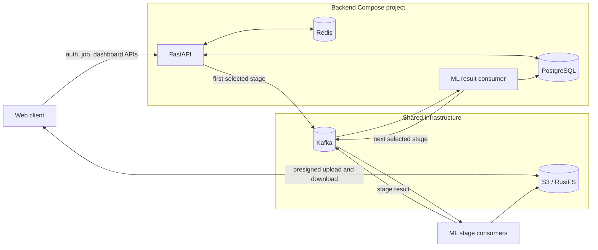
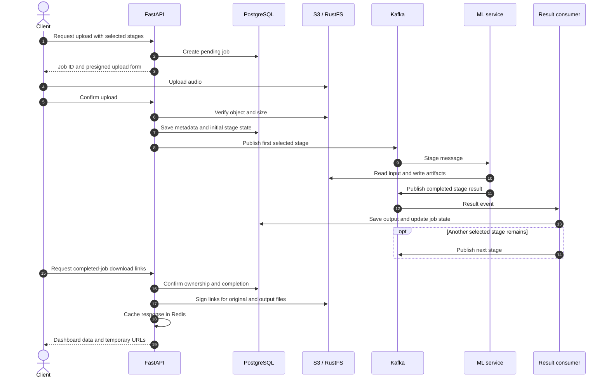

# SonClarus Backend

## API and event coordination for the audio pipeline

FastAPI, PostgreSQL, Redis, Kafka, and S3-compatible storage.

[Project overview](../README.md) | [ML service](../ml/README.md) | [Architecture diagram](../architecture.svg)

---

## Service responsibilities

The backend handles accounts, authentication, upload coordination, job state, and the handoff between Kafka and the ML service. Audio bytes move directly between the client and S3-compatible storage; the API works with short-lived signed URLs and file metadata.

It runs as two application processes:

- **API (`main.py`)** serves auth, user, and job routes. It writes job records and publishes the first selected stage.
- **Result consumer (`run_consumer.py`)** reads ML results, saves stage outputs, and publishes the next selected stage. It commits each Kafka message only after its database transaction succeeds.

## Architecture



### Job lifecycle



## HTTP API

API routes return a consistent JSON envelope: `message`, `status_code`, `data`, and `meta`. Protected operations use bearer access tokens; refresh tokens are kept in an HTTP-only cookie.

| Method | Route | Access | Description |
|---|---|---|---|
| `POST` | `/auth/signup` | Public | Create an account. |
| `POST` | `/auth/login` | Public | Authenticate and issue tokens. |
| `POST` | `/auth/refresh` | Refresh cookie | Rotate the refresh token. |
| `POST` | `/auth/logout` | Optional token/cookie | Revoke the current session. |
| `GET` | `/users/me` | Signed-in user | Get profile and storage totals. |
| `POST` | `/jobs/request-upload` | Verified user | Create a job and request an upload URL. |
| `POST` | `/jobs/{job_id}/confirm-upload` | Verified user | Verify the uploaded object and queue the first stage. |
| `GET` | `/jobs/{job_id}/download-links` | Verified user | Get completed job metadata and artifact links. |
| `GET` | `/health` | Public | Check that the API responds. |

### Download payload

The download route returns data only when the job belongs to the verified user and its `completed` field is true. It returns `404` if no owned job matches and `409` while processing is incomplete.

`DownloadLinksResponse` in [`jobs/schemas.py`](src/sonclarus/jobs/schemas.py) describes the dashboard payload: job timeline and selected stages, original file metadata including its hash, stage metadata, and signed links for saved files. The service validates and serializes the response with `model_dump(mode="json")`. Redis stores that JSON-safe result until the download URLs expire.

### URL lifetimes

| Environment variable | Used for | Example |
|---|---|---:|
| `UPLOAD_URL_TTL_SECONDS` | Presigned upload URL lifetime | `360` seconds |
| `DOWNLOAD_URL_TTL_SECONDS` | Presigned download URL and Redis cache lifetime | `360` seconds |

The two settings are independent. Set them to the same value for matching expirations, or adjust each for your client and storage workflow. Both values must be positive.

## Local development

### Configure

From this directory:

```bash
cp example.env .env
```

Edit the values in `.env`. The example targets the Compose services (`postgres`, `redis`, and `kafka`) and local RustFS. For direct AWS S3 use, clear `AWS_ENDPOINT_URL` and `AWS_PUBLIC_ENDPOINT_URL`; for RustFS, keep the internal endpoint reachable by containers and the public endpoint reachable by the browser.

Create the shared networks once per Docker host, then start the separate infrastructure projects:

```bash
docker network create my-kafka-net
docker network create my-storage-net
docker compose -p kafka-local -f compose.kafka.yml up -d
docker compose -p rustfs-local -f compose.rustfs.yml up -d
```

Create the bucket configured by `AWS_BUCKET_NAME` in the RustFS console at [http://localhost:9001](http://localhost:9001). Then start PostgreSQL, Redis, migrations, API, and result consumer:

```bash
docker compose up --build
```

API: [http://localhost:8000](http://localhost:8000) · OpenAPI docs: [http://localhost:8000/docs](http://localhost:8000/docs) · Health: [http://localhost:8000/health](http://localhost:8000/health)

For backend logs:

```bash
docker compose logs -f backend result_consumer
```

Start the ML consumers from `../ml` as described in the [ML README](../ml/README.md). Kafka and RustFS are separate Compose projects, so start them before the backend and ML services.

## Configuration

Settings are loaded with Pydantic Settings from [`shared/config.py`](src/sonclarus/shared/config.py). `example.env` is the variable reference; keep real secrets in the ignored `.env` file.

| Group | Variables | Purpose |
|---|---|---|
| Database | `POSTGRES_*` | PostgreSQL connection for API and consumer. |
| Cache | `REDIS_*` | Token revocation and cached download responses. |
| Events | `KAFKA_*` | Broker, stage topics, result topic, and consumer group. |
| Storage | `AWS_*` | S3/RustFS credentials, bucket, and signing endpoints. |
| Link expiry | `UPLOAD_URL_TTL_SECONDS`, `DOWNLOAD_URL_TTL_SECONDS` | Independent presigned URL and cache lifetimes. |
| Security | `JWT_SECRET_KEY`, token expiry settings | Access and refresh-token behavior. |
| App | `PROJECT_*`, `DOCS_ENDPOINT`, `MAX_FILE_SIZE`, `ALLOWED_*` | API identity, file limit, and CORS policy. |
| Summarize | `GEMINI_API_KEY` | Credential shared with the summarize stage. |

## Code map

```text
src/sonclarus/
├── api/          Route aggregation
├── auth/         Authentication, token lifecycle, and user dependencies
├── jobs/         Upload and job lifecycle, schemas, result handling
├── users/        User profile and storage data
├── shared/       Settings, DB sessions, Kafka, Redis, S3, API response
├── main.py       FastAPI app and lifespan
└── run_consumer.py  Backend ML-result consumer

alembic/          Database migrations
compose.yml       PostgreSQL, Redis, migration, API, result consumer
compose.kafka.yml Shared local Kafka broker
compose.rustfs.yml Shared local RustFS service
example.env       Local environment template
```

## Data and reliability

- PostgreSQL is the source of truth for users, job state, original-file metadata, and stage outputs.
- Each result is applied under a row lock. The consumer acknowledges the Kafka message only after successful processing and transaction commit.
- If a result advances the job, the backend flushes the updated row and publishes the next-stage event before the database transaction commits. A publish failure rolls back the row update and leaves the result uncommitted for retry. PostgreSQL and Kafka do not share a distributed transaction, so this is not atomic across both systems.
- The download response cache is scoped by both user ID and job ID. Its expiration matches `DOWNLOAD_URL_TTL_SECONDS`.
- Database schema changes are managed by Alembic; the Compose `migrate` service upgrades to the current migration head before application services start.

## Related documentation

- [Full project README](../README.md) — product overview and complete service architecture
- [ML README](../ml/README.md) — models, consumer options, and ML configuration
- [Architecture diagram](../architecture.svg) — visual system map
