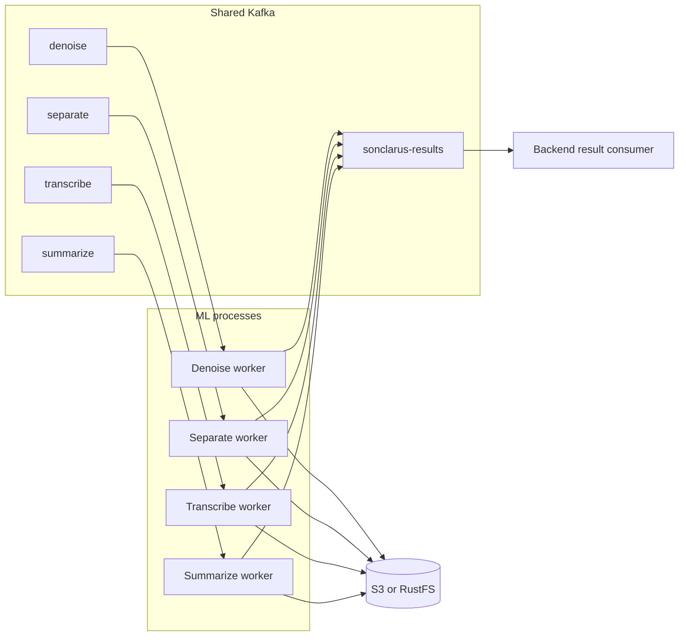

# SonClarus ML Service

The ML service runs audio-processing stages as independent Kafka consumers. Each worker downloads its input from S3-compatible storage, runs one model, uploads the resulting artifact, and publishes a completion event for the backend.

**Runtime:** Python 3.11 · Kafka · S3 or RustFS · DeepFilterNet · SepFormer · Faster Whisper · Gemini

[Project overview](../README.md) | [Backend guide](../backend/README.md) | [System architecture](../architecture.svg)

## Responsibilities

The backend owns users, job state, selected-stage order, and database writes. The ML service owns model inference and artifact creation. It does not connect to PostgreSQL.



Each stage has its own process, Kafka group, and model lifecycle. With no flags, the launcher runs all four consumers in parallel. Pass one or more stage flags to run only those consumers.

## Processing stages

| Stage | Model | Output |
|---|---|---|
| `denoise` | DeepFilterNet3 | `<input>_cleaned.wav` |
| `separate` | SpeechBrain SepFormer (`wsj02mix`) | `<input>_speaker_1.wav` and `<input>_speaker_2.wav` |
| `transcribe` | Faster Whisper | One `<input>_full_script.txt` transcript |
| `summarize` | Gemini API | One `<transcript>_summary.txt` file |

When transcription receives two separated tracks, it writes one time-sorted transcript with speaker labels. With one input file, it writes one transcript without speaker labels.

## Run with Docker Compose

The Compose service uses Python 3.11, stores downloaded model files in a named volume, and joins the shared `my-kafka-net` and `my-storage-net` networks. Start Kafka and RustFS first; setup instructions are in the [root README](../README.md).

From this directory:

```bash
cp example.env .env
```

Set the credentials and bucket to the same values used by the backend. The default Compose addresses are `kafka:19092` and `http://rustfs:9000`. To override them, set `ML_KAFKA_BOOTSTRAP_SERVERS` or `ML_AWS_ENDPOINT_URL` in the Compose environment or `ml/.env`.

Start all four workers:

```bash
docker compose up --build -d
```

Follow logs or stop the service:

```bash
docker compose logs -f ml
docker compose down
```

The model cache persists in the `sonclarus-ml_ml-model-cache` Docker volume. The first startup downloads the model artifacts. To force a fresh model download, remove that volume with `docker compose down -v`.

## Run directly on a host

Use Python 3.11 and configure the values in `example.env` for services reachable from the host. For local Kafka and RustFS, the typical addresses are `localhost:9092` and `http://localhost:9000`.

```bash
cp example.env .env
python3.11 -m venv .venv
source .venv/bin/activate
python -m pip install -r requirements.txt
python start_consumers.py
```

Run selected consumers with flags such as `python start_consumers.py --denoise --transcribe`. Supported flags are `--denoise`, `--separate`, `--transcribe`, and `--summarize`. With no flags, all stages start.

The launcher starts one process per selected stage, loads that stage's inference module inside its process, and restarts a worker if it exits. `Ctrl+C` or a termination signal shuts down the workers.

## Resource and model behavior

- `ML_TORCH_NUM_THREADS` defaults to `2` and sets the Torch intra-op thread count in each Torch-based worker. The value is per process, not a service-wide CPU limit.
- Device selection defaults to CUDA when the installed Torch build and runtime can use it; otherwise the audio models use CPU. `SEPARATOR_DEVICE` and `WHISPER_DEVICE` can override their stage's device.
- Each stage process holds its own model in memory. Running all stages concurrently uses more memory than running one stage; the model cache volume only persists downloaded model files, not loaded model memory.
- The default transcription model is `base` with `int8` compute. Separator chunk size, VAD settings, denoise post-filtering, and other model parameters are configurable in `example.env`.

## Message handling

Each input message is validated before processing. The worker downloads the required file or files, runs inference in a worker thread, uploads every output, and then publishes one result event. It commits the input offset only after the result event has been published successfully.

On processing failure, the worker seeks back to the failed offset and retries after a short delay. There is no dead-letter topic in this worker implementation; a message that fails repeatedly will continue to block later messages in its partition until the cause is fixed or the message is handled operationally.

The result event contains:

| Field | Description |
|---|---|
| `job_id`, `user_id` | Identifiers from the stage request. |
| `completed_stage` | Stage that produced the result. |
| `is_initial` | Whether this was the first selected stage for the source file. |
| `file_hash` | Streaming SHA-256 for the initial input; `null` on later stages. |
| `stage_data` | Stage status, output location, filenames, size, and completion time. |
| `outputs` | Metadata for each uploaded artifact. Separation returns two entries. |
| `completed_at` | UTC completion timestamp. |

The hash helper reads the source in 1 MiB chunks, so it does not load the entire file into memory. The backend result consumer persists this event and schedules the next selected stage.

## Configuration

`shared/config.py` loads settings with Pydantic Settings from `ml/.env` and environment variables. [`example.env`](example.env) lists the supported values.

| Group | Variables | Purpose |
|---|---|---|
| Kafka | `KAFKA_BOOTSTRAP_SERVERS`, `KAFKA_CLIENT_ID`, topic and security variables | Broker connection, input topics, result topic, and security. |
| Storage | `AWS_ACCESS_KEY_ID`, `AWS_SECRET_ACCESS_KEY`, `AWS_REGION`, `AWS_BUCKET_NAME`, `AWS_ENDPOINT_URL` | S3-compatible artifact transfers. |
| Worker | `ML_WORK_DIR`, `ML_TORCH_NUM_THREADS` | Temporary files and per-process Torch thread count. |
| Gemini | `GEMINI_API_KEY`, `GEMINI_MODEL`, `GEMINI_TIMEOUT_S` | Summarization API connection. |
| Denoise | `DF_*` | DeepFilterNet model and post-filter settings. |
| Separate | `SEPFORMER_*`, `SEPARATOR_*` | SepFormer source, cache path, sample rate, chunks, and device. |
| Transcribe | `WHISPER_*` | Faster Whisper model, compute type, VAD, and device. |

For `SASL_SSL`, also set `KAFKA_SASL_MECHANISM`, `KAFKA_SASL_USERNAME`, and `KAFKA_SASL_PASSWORD`. The ML `KAFKA_CLIENT_ID` should use the same shared application identifier as the backend; each ML consumer adds its stage name to its consumer client ID.

## Repository layout

```text
ml/
├── src/sonclarus_ml/
│   ├── denoise/       DeepFilterNet inference and input validation
│   ├── separate/      SepFormer inference and audio preparation
│   ├── transcribe/    Faster Whisper inference and transcript formatting
│   ├── summarize/     Gemini summarization
│   └── shared/        Settings, Kafka, S3, hashing, and consumer lifecycle
├── start_consumers.py Process launcher and worker supervisor
├── Dockerfile         Python 3.11 runtime image
├── compose.yml        Worker service and shared networks
├── requirements.txt   Resolved Linux/Python 3.11 dependencies
└── example.env        Local configuration template
```
